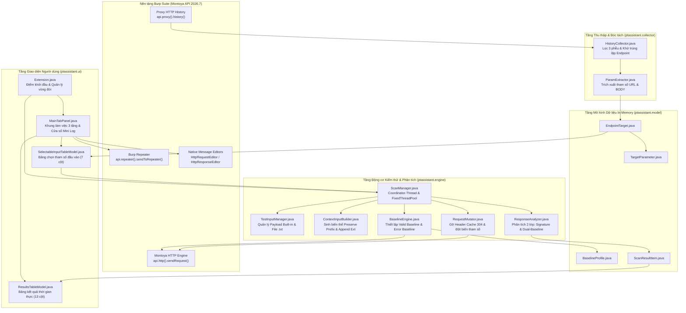

# TÀI LIỆU THIẾT KẾ KIẾN TRÚC HỆ THỐNG, MÔ HÌNH DỮ LIỆU & LƯU ĐỒ THUẬT TOÁN
**(Mã giao nộp: `R.4.1 - Thiết kế`, `C.2.2 - Project Description`, `C.3.1 - Mô hình dữ liệu In-Memory`)**

- **Tên dự án**: Công cụ hỗ trợ kiểm thử tự động lỗ hổng Path Traversal trên Burp Suite (*Path Traversal Assistant — PT Assistant*)
- **Sinh viên thực hiện**: Trần Viết Tùng Lâm
- **Giảng viên hướng dẫn**: TS. Vũ Thị Hương Giang
- **Nền tảng kỹ thuật**: Java 21 | Gradle 8.x | Burp Suite Montoya API `2026.7` | Java Swing UI

---

## 1. THIẾT KẾ KIẾN TRÚC TỔNG THỂ (SYSTEM ARCHITECTURE)

### 1.1. Mô hình Phân tầng Kiến trúc 4 Gói (4-Package Layered Architecture)

Hệ thống **PT Assistant** được thiết kế theo kiến trúc hướng mô-đun (Modular Layered Architecture) chạy trực tiếp trong không gian tiến trình của **Burp Suite** thông qua giao diện lập trình **Montoya API `2026.7`**. Toàn bộ mã nguồn gồm **16 lớp (classes)** chia thành 4 tầng độc lập:

1. **Tầng Giao diện Người dùng (`ptassistant.ui`)**: Quản lý không gian làm việc 3 tầng (*1. Injectable Inputs* $\rightarrow$ *2. Scan Results* $\rightarrow$ *3. Evidence Inspector*), cửa sổ nhật ký kỹ thuật độc lập (*Mini Log Window*) và các mô hình bảng dữ liệu thời gian thực hỗ trợ lọc/sắp xếp.
2. **Tầng Thu thập & Bóc tách (`ptassistant.collector`)**: Kết nối với `Proxy HTTP History` của Burp Suite, thực thi cơ chế lọc 3 phễu để loại bỏ tài nguyên tĩnh, trích xuất tham số `URL Query` & `POST Body (application/x-www-form-urlencoded)` và khử trùng lặp cấu trúc Endpoint.
3. **Tầng Động cơ Kiểm thử & Phân tích (`ptassistant.engine`)**: Điều phối luồng quét bất đồng bộ (`Coordinator-Thread` + `FixedThreadPool`), thiết lập mẫu tham chiếu kép (*Dual-Baseline*), sinh biến thể ngữ cảnh, đột biến gói tin HTTP an toàn và phân tích phản hồi 2 lớp.
4. **Tầng Mô hình Dữ liệu In-Memory (`ptassistant.model`)**: Biểu diễn các thực thể dữ liệu cốt lõi trong bộ nhớ RAM với cơ chế đồng bộ luồng (`volatile`, `ConcurrentHashMap`, `Collections.synchronizedList`).

---

### 1.2. Bảng Đặc tả Chi tiết 16 Lớp (Classes) trong Mã nguồn và Ánh xạ PBI

| STT | Gói (Package) | Tên Lớp (Class) | Trách nhiệm Kỹ thuật & Phương thức Cốt lõi | Ánh xạ PBI gốc |
| :---: | :--- | :--- | :--- | :---: |
| 1 | `ptassistant` | [`Extension`](file:///home/lamtvt/Desktop/2026.1/Prj3/Extension/src/main/java/ptassistant/Extension.java) | Cài đặt `BurpExtension.initialize(MontoyaApi)`. Khởi tạo các mô-đun, đăng ký Tab `PT Assistant`, đăng ký menu chuột phải `Send to PT Assistant` và `UnloadingHandler` để giải phóng ThreadPool khi gỡ Extension. | `PBI-001` |
| 2 | `ptassistant.collector` | [`HistoryCollector`](file:///home/lamtvt/Desktop/2026.1/Prj3/Extension/src/main/java/ptassistant/collector/HistoryCollector.java) | Quét `api.proxy().history()`, trích xuất danh sách Host (`collectDistinctHosts`), lọc Endpoint theo Host (`collectByHost`) hoặc Scope (`collectFromHistory`), loại bỏ 15 đuôi file tĩnh và khử trùng lặp theo chữ ký cấu trúc. | `PBI-001` |
| 3 | `ptassistant.collector` | [`ParamExtractor`](file:///home/lamtvt/Desktop/2026.1/Prj3/Extension/src/main/java/ptassistant/collector/ParamExtractor.java) | Bóc tách danh sách tham số từ `HttpRequest` (`extractSupportedParams`), chỉ thu nhận `HttpParameterType.URL` và `HttpParameterType.BODY` (`application/x-www-form-urlencoded`). | `PBI-002`, `PBI-003` |
| 4 | `ptassistant.model` | [`TargetParameter`](file:///home/lamtvt/Desktop/2026.1/Prj3/Extension/src/main/java/ptassistant/model/TargetParameter.java) | Đối tượng bất biến (immutable) lưu trữ thông tin một tham số mục tiêu gồm: tên (`name`), giá trị gốc (`originalValue`) và vị trí (`HttpParameterType`). Cài đặt `equals`/`hashCode` để làm khóa tra cứu. | `PBI-002`, `PBI-003` |
| 5 | `ptassistant.model` | [`EndpointTarget`](file:///home/lamtvt/Desktop/2026.1/Prj3/Extension/src/main/java/ptassistant/model/EndpointTarget.java) | Đại diện một Endpoint duy nhất cần kiểm thử: lưu giữ `baseRequest`, danh sách `List<TargetParameter>`, hồ sơ `Valid Baseline` (`volatile`) và bảng ánh xạ `ConcurrentHashMap<TargetParameter, BaselineProfile>` cho `Error Baseline` của từng tham số. | `PBI-001`, `PBI-007` |
| 6 | `ptassistant.model` | [`BaselineProfile`](file:///home/lamtvt/Desktop/2026.1/Prj3/Extension/src/main/java/ptassistant/model/BaselineProfile.java) | Hồ sơ tham chiếu lưu giữ đối tượng `HttpResponse` gốc cùng 5 chỉ số đặc trưng (`statusCode`, `contentType`, `contentLength`, `lineCount`, `wordCount`), thời gian phản hồi (`responseTimeMs`) và số lần phản xạ chuỗi thăm dò (`reflectionCount`, `probeLength`). | `PBI-007` |
| 7 | `ptassistant.model` | [`ScanResultItem`](file:///home/lamtvt/Desktop/2026.1/Prj3/Extension/src/main/java/ptassistant/model/ScanResultItem.java) | Lưu trữ toàn bộ dữ liệu của một lượt bắn kiểm thử: tên luồng thực thi (`workerName`), `EndpointTarget`, `TargetParameter`, chuỗi `testInput`, `sentRequest`, `receivedResponse`, 5 chỉ số HTTP, độ lệch phần trăm kích thước (`lengthDiffPercent`), nhãn phân loại (`flag`: `NOTABLE`/`NORMAL`) và lý do (`reason`). | `PBI-009`, `PBI-010`, `PBI-012` |
| 8 | `ptassistant.engine` | [`TestInputManager`](file:///home/lamtvt/Desktop/2026.1/Prj3/Extension/src/main/java/ptassistant/engine/TestInputManager.java) | Quản lý danh sách chuỗi kiểm thử đầu vào: cung cấp bộ 16 payload đa tầng mặc định (*Built-in*) hoặc đọc tệp từ điển `.txt` bên ngoài (`loadFromFile`), tự động lọc bỏ dòng trống và dòng chú thích `#`. | `PBI-006` |
| 9 | `ptassistant.engine` | [`ContextInputBuilder`](file:///home/lamtvt/Desktop/2026.1/Prj3/Extension/src/main/java/ptassistant/engine/ContextInputBuilder.java) | Sinh danh sách chuỗi kiểm thử theo ngữ cảnh giá trị gốc của từng tham số (`buildInputsForParam`), hỗ trợ ghép tiền tố thư mục gốc (`preservePrefix`) và nối phần mở rộng tệp kèm Null-byte `%00` (`appendExtension`), khử trùng lặp qua `LinkedHashSet`. | `PBI-006` |
| 10 | `ptassistant.engine` | [`BaselineEngine`](file:///home/lamtvt/Desktop/2026.1/Prj3/Extension/src/main/java/ptassistant/engine/BaselineEngine.java) | Thiết lập mẫu tham chiếu trực tiếp trước phiên quét: `captureFreshBaseline` (gỡ header cache và gửi lại request gốc) và `captureErrorBaseline` (tiêm chuỗi giả `pt_nonexistent_ref_<6_digits>` vào tham số đang xét). | `PBI-007` |
| 11 | `ptassistant.engine` | [`RequestMutator`](file:///home/lamtvt/Desktop/2026.1/Prj3/Extension/src/main/java/ptassistant/engine/RequestMutator.java) | Tạo bản sao `HttpRequest` mới với tham số đã cập nhật (`mutateParameter`): gỡ bỏ 4 header `If-Modified-Since` / `If-None-Match`, bảo toàn các chuỗi đã mã hóa `%` trong payload và chỉ mã hóa `&` $\rightarrow$ `%26`, `=` $\rightarrow$ `%3D` đối với `POST Body`. | `PBI-008` |
| 12 | `ptassistant.engine` | [`ResponseAnalyzer`](file:///home/lamtvt/Desktop/2026.1/Prj3/Extension/src/main/java/ptassistant/engine/ResponseAnalyzer.java) | Bộ phân tích đối chiếu 2 lớp (`evaluate`): Lớp 1 kiểm tra biểu thức chính quy cấu trúc tệp hệ thống (`/etc/passwd`, `win.ini`); Lớp 2 đối chiếu với `Error Baseline` (có bù độ dài phản xạ) và `Valid Baseline` để gán nhãn `NOTABLE` hoặc `NORMAL`. | `PBI-010`, `PBI-011` |
| 13 | `ptassistant.engine` | [`ScanManager`](file:///home/lamtvt/Desktop/2026.1/Prj3/Extension/src/main/java/ptassistant/engine/ScanManager.java) | Bộ điều phối trung tâm: khởi chạy `Coordinator-Thread` tách biệt khỏi luồng giao diện, thu thập Baseline tuần tự, phân phối tác vụ kiểm thử vào `FixedThreadPool` (`PT-Worker-1..N`), quản lý `Delay (ms)` và dừng an toàn (`stopScan`, `shutdown`). | `PBI-009` |
| 14 | `ptassistant.ui` | [`SelectableInputTableModel`](file:///home/lamtvt/Desktop/2026.1/Prj3/Extension/src/main/java/ptassistant/ui/SelectableInputTableModel.java) | Mô hình bảng `AbstractTableModel` 7 cột hiển thị danh sách tham số đầu vào có cột Checkbox `Inject?` (`Boolean.class`), hỗ trợ chọn nhanh tất cả, bỏ chọn, chỉ chọn URL hoặc chỉ chọn BODY. | `PBI-002`, `PBI-003`, `PBI-006` |
| 15 | `ptassistant.ui` | [`ResultsTableModel`](file:///home/lamtvt/Desktop/2026.1/Prj3/Extension/src/main/java/ptassistant/ui/ResultsTableModel.java) | Mô hình bảng `AbstractTableModel` 13 cột hiển thị kết quả quét thời gian thực, trả về đúng kiểu dữ liệu số (`Integer`, `Double`, `Long`) để `TableRowSorter` sắp xếp chính xác theo đại lượng toán học. | `PBI-012` |
| 16 | `ptassistant.ui` | [`MainTabPanel`](file:///home/lamtvt/Desktop/2026.1/Prj3/Extension/src/main/java/ptassistant/ui/MainTabPanel.java) | Giao diện chính chia 3 tầng bằng `JSplitPane`, tích hợp thanh điều khiển 2 hàng, bộ lọc `Only NOTABLE` + ô tìm kiếm từ khóa, khung `Evidence Inspector` 3 tab nhúng trình soạn thảo gốc của Burp, nút `Send to Repeater` và cửa sổ `Mini Log Window`. | `PBI-006`, `PBI-012`, `PBI-013` |

---

## 2. SƠ ĐỒ LỚP UML TOÀN HỆ THỐNG (FULL 16-CLASS UML DIAGRAM) & MÔ HÌNH DỮ LIỆU (`C.3.1`)

### 2.1. Sơ đồ Lớp UML Tổng thể (16 Classes thuộc 4 Packages)

Sơ đồ dưới đây biểu diễn đầy đủ thuộc tính, phương thức cốt lõi và mối quan hệ phụ thuộc/kết tập (Composition, Aggregation, Dependency) giữa toàn bộ **16 lớp** trong mã nguồn:

```mermaid
classDiagram
    direction TB

    %% ==========================================
    %% PACKAGE 1: ENTRY POINT & UI (ptassistant & ptassistant.ui)
    %% ==========================================
    class Extension {
        -BaselineEngine baselineEngine
        -TestInputManager testInputManager
        -MainTabPanel mainTabPanel
        -ScanManager scanManager
        +initialize(MontoyaApi) void
        -extractRequest(ContextMenuEvent) HttpRequest
        -logBoth(MontoyaApi, String) void
    }

    class MainTabPanel {
        -MontoyaApi api
        -TestInputManager testInputManager
        -SelectableInputTableModel inputTableModel
        -ResultsTableModel resultsTableModel
        -HttpRequestEditor sentRequestEditor
        -HttpResponseEditor receivedResponseEditor
        -HttpResponseEditor baselineResponseEditor
        -JDialog logDialog
        +updateHostList(List~String~, String) void
        +loadDiscoveredTargets(String, List~EndpointTarget~) void
        +getSelectedTargetsForScan() List~EndpointTarget~
        +addScanResultRow(ScanResultItem) void
        +updateProgress(int, int, int) void
        +setRunningState(boolean) void
        +appendLog(String) void
        +disposeAuxWindows() void
    }

    class SelectableInputTableModel {
        -List~InputRow~ rows
        +setTargets(List~EndpointTarget~) void
        +selectAll() void
        +deselectAll() void
        +selectByType(HttpParameterType) void
        +buildSelectedEndpointTargets() List~EndpointTarget~
        +getRowCount() int
        +getColumnCount() int
    }

    class ResultsTableModel {
        -List~ScanResultItem~ items
        +addResult(ScanResultItem) int
        +getItemAtModelRow(int) ScanResultItem
        +clear() void
        +getRowCount() int
        +getColumnCount() int
    }

    %% ==========================================
    %% PACKAGE 2: COLLECTOR (ptassistant.collector)
    %% ==========================================
    class HistoryCollector {
        -Set~String~ STATIC_EXTENSIONS$
        +collectDistinctHosts(MontoyaApi)$ List~String~
        +collectByHost(MontoyaApi, String)$ List~EndpointTarget~
        +collectFromHistory(MontoyaApi, boolean)$ List~EndpointTarget~
        +extractCleanPath(HttpRequest)$ String
        +buildParamSignature(List~TargetParameter~)$ String
    }

    class ParamExtractor {
        +extractSupportedParams(HttpRequest)$ List~TargetParameter~
    }

    %% ==========================================
    %% PACKAGE 3: ENGINE (ptassistant.engine)
    %% ==========================================
    class ScanManager {
        -MontoyaApi api
        -BaselineEngine baselineEngine
        -TestInputManager testInputManager
        -MainTabPanel mainTabPanel
        -AtomicBoolean scanning
        -volatile boolean stopRequested
        -volatile ExecutorService workerPool
        -volatile Thread coordinatorThread
        -List~ScanResultItem~ collectedResults
        +startBatchScan(List~EndpointTarget~, String) void
        -runCoordinatorLoop(List~EndpointTarget~, String) void
        -executeSingleTestTask(EndpointTarget, TargetParameter, String, int, AtomicInteger, int, int) void
        +stopScan() void
        +shutdown() void
        +isRunning() boolean
    }

    class BaselineEngine {
        -String NON_EXISTENT_PREFIX$
        +captureFreshBaseline(MontoyaApi, HttpRequest) BaselineProfile
        +captureErrorBaseline(MontoyaApi, HttpRequest, TargetParameter) BaselineProfile
    }

    class TestInputManager {
        -List~String~ DEFAULT_BUILT_IN_INPUTS$
        -List~String~ currentInputs
        -String sourceDescription
        +loadFromFile(File) int
        +resetToDefault() void
        +getInputs() List~String~
        +getSourceDescription() String
    }

    class ContextInputBuilder {
        -Pattern VALID_EXTENSION_PATTERN$
        +buildInputsForParam(TargetParameter, List~String~, boolean, boolean)$ List~String~
    }

    class RequestMutator {
        +mutateParameter(HttpRequest, TargetParameter, String)$ HttpRequest
    }

    class ResponseAnalyzer {
        -Pattern POSIX_COLON_RECORD_PATTERN$
        -Pattern SYSTEM_INI_SECTION_PATTERN$
        +evaluate(ScanResultItem, BaselineProfile, BaselineProfile)$ void
        -matchesStructuredSystemConfigPattern(String)$ boolean
        -isSameContentTypeGroup(String, String)$ boolean
    }

    %% ==========================================
    %% PACKAGE 4: MODEL (ptassistant.model)
    %% ==========================================
    class EndpointTarget {
        -HttpRequest baseRequest
        -List~TargetParameter~ parameters
        -volatile BaselineProfile baseline
        -Map~TargetParameter, BaselineProfile~ errorBaselines
        +getBaseRequest() HttpRequest
        +getParameters() List~TargetParameter~
        +getBaseline() BaselineProfile
        +setBaseline(BaselineProfile) void
        +getErrorBaseline(TargetParameter) BaselineProfile
        +setErrorBaseline(TargetParameter, BaselineProfile) void
        +hasVisibleParams() boolean
    }

    class TargetParameter {
        -String name
        -String originalValue
        -HttpParameterType type
        +getName() String
        +getOriginalValue() String
        +getType() HttpParameterType
        +equals(Object) boolean
        +hashCode() int
    }

    class BaselineProfile {
        -HttpResponse rawResponse
        -int statusCode
        -String contentType
        -int contentLength
        -int lineCount
        -int wordCount
        -long responseTimeMs
        -int probeLength
        -int reflectionCount
        +getRawResponse() HttpResponse
        +getStatusCode() int
        +getContentType() String
        +getContentLength() int
        +getLineCount() int
        +getWordCount() int
        +getProbeLength() int
        +getReflectionCount() int
        +toSummaryString() String
    }

    class ScanResultItem {
        -int rowIndex
        -String workerName
        -EndpointTarget endpoint
        -String endpointLabel
        -TargetParameter parameter
        -String testInput
        -HttpRequest sentRequest
        -HttpResponse receivedResponse
        -int statusCode
        -String contentType
        -int contentLength
        -int lineCount
        -int wordCount
        -double lengthDiffPercent
        -long responseTimeMs
        -volatile String flag
        -volatile String reason
        +getFlag() String
        +setFlag(String) void
        +getReason() String
        +setReason(String) void
        +getLengthDiffPercent() double
    }

    %% ==========================================
    %% MỐI QUAN HỆ GIỮA CÁC LỚP (RELATIONSHIPS)
    %% ==========================================
    Extension *-- MainTabPanel : initializes
    Extension *-- ScanManager : initializes
    Extension *-- BaselineEngine : initializes
    Extension *-- TestInputManager : initializes
    Extension ..> HistoryCollector : calls
    Extension ..> ParamExtractor : calls

    MainTabPanel *-- SelectableInputTableModel : contains
    MainTabPanel *-- ResultsTableModel : contains
    MainTabPanel o-- TestInputManager : configures

    HistoryCollector ..> ParamExtractor : delegates
    HistoryCollector ..> EndpointTarget : creates
    ParamExtractor ..> TargetParameter : creates

    SelectableInputTableModel o-- EndpointTarget : displays
    ResultsTableModel o-- ScanResultItem : stores

    ScanManager o-- BaselineEngine : uses
    ScanManager o-- TestInputManager : reads
    ScanManager o-- MainTabPanel : updates UI
    ScanManager ..> ContextInputBuilder : calls
    ScanManager ..> RequestMutator : calls
    ScanManager ..> ResponseAnalyzer : calls
    ScanManager *-- ScanResultItem : collects

    BaselineEngine ..> RequestMutator : calls
    BaselineEngine ..> BaselineProfile : creates
    ContextInputBuilder ..> TargetParameter : inspects
    RequestMutator ..> TargetParameter : mutates
    ResponseAnalyzer ..> ScanResultItem : evaluates
    ResponseAnalyzer ..> BaselineProfile : compares

    EndpointTarget "1" *-- "0..*" TargetParameter : contains
    EndpointTarget "1" o-- "0..1" BaselineProfile : validBaseline
    EndpointTarget "1" o-- "0..*" BaselineProfile : errorBaselines
    ScanResultItem "*" --> "1" EndpointTarget : references
    ScanResultItem "*" --> "1" TargetParameter : tests
```

### 2.2. Đặc tả Mô hình Lưu trữ In-Memory (`ptassistant.model`)
Do đặc thù của một tiện ích mở rộng chạy tích hợp bên trong Burp Suite, hệ thống quản lý toàn bộ trạng thái phiên kiểm thử trực tiếp trong bộ nhớ RAM (*In-Memory Data Model*) với các cơ chế đồng bộ luồng:
- **`EndpointTarget`**: Sử dụng từ khóa `volatile` cho `baseline` và `ConcurrentHashMap<TargetParameter, BaselineProfile>` cho `errorBaselines` để nhiều luồng công nhân (`PT-Worker-1..N`) truy xuất đồng thời không bị khóa nghẽn.
- **`ScanResultItem`**: Tự động trích xuất các chỉ số HTTP và tính `lengthDiffPercent` ngay trong hàm khởi tạo; hai thuộc tính `flag` và `reason` được khai báo `volatile` để đảm bảo tính nhất quán bộ nhớ giữa luồng Worker và luồng giao diện Swing EDT.

---

## 3. THIẾT KẾ LƯU ĐỒ THUẬT TOÁN 4 GIAI ĐOẠN (ALGORITHMIC PIPELINE)

### 3.1. Lưu đồ Thực thi Tổng thể End-to-End

```mermaid
flowchart TD
    Start(["1. Tester duyệt trang web mục tiêu qua Burp Browser"]) --> CollectBtn["2. Chọn Host & Nhấn '1. Collect Host Inputs'"]
    
    subgraph PHASE1["GIAI ĐOẠN 1: THU THẬP & KHỬ TRÙNG LẶP 3 PHỄU (HistoryCollector)"]
        CollectBtn --> F1["Phễu 1: Lọc các bản ghi Proxy History khớp Host mục tiêu"]
        F1 --> F2["Phễu 2: Tách cleanPath trước dấu '?'<br/>Loại bỏ 15 đuôi file tĩnh (.js, .css, .png, .jpg, .woff2...)"]
        F2 --> F3["Phễu 3: Bóc tách tham số URL & BODY (ParamExtractor)<br/>Sinh chữ ký cấu trúc: METHOD | cleanPath | sortedParamNames"]
        F3 --> Dedup["Ghi vào LinkedHashMap.put(signature, target)<br/>LUÔN GIỮ BẢN GHI MỚI NHẤT (bảo toàn Cookie/Session mới nhất)"]
    end

    Dedup --> SplitParam{"Endpoint có tham số<br/>hiển thị (>0 params)?"}
    SplitParam -- "Không (0 params)" --> ZeroBucket["Ghi nhận vào nhóm 0-param<br/>(Chuẩn bị cho mô-đun Hidden Parameter Discovery)"]
    SplitParam -- "Có (>=1 params)" --> SelectTable["Hiển thị lên Bảng '1. Injectable Inputs'<br/>Tester tích chọn tham số -> Nhấn '2. Start Scan'"]

    subgraph PHASE2["GIAI ĐOẠN 2: THIẾT LẬP MẪU THAM CHIẾU KÉP (BaselineEngine - Tuần tự)"]
        SelectTable --> CleanHdr["Gỡ bỏ 4 Header điều kiện Cache:<br/>If-Modified-Since, If-None-Match (hoa & thường)"]
        CleanHdr --> ValidBase["Gửi lại BaseRequest gốc -> Thu 'Valid Baseline'<br/>(Status, Content-Type, ContentLength, LineCount, WordCount)"]
        ValidBase --> ErrBase["Với từng Parameter được chọn:<br/>Tiêm chuỗi thăm dò 'pt_nonexistent_ref_<6_digits>' (25 ký tự)<br/>-> Thu 'Error Baseline' & Đếm số lần phản xạ (r lần)"]
    end

    subgraph PHASE3["GIAI ĐOẠN 3: SINH BIẾN THỂ & BẮN ĐA LUỒNG (ScanManager & RequestMutator)"]
        ErrBase --> CtxExpand["Nạp danh sách Payload (Built-in / File .txt)<br/>+ Sinh biến thể ngữ cảnh qua ContextInputBuilder"]
        CtxExpand --> ThreadPool["Đẩy tác vụ vào FixedThreadPool (PT-Worker-1..N)<br/>RequestMutator.mutateParameter():<br/>- URL: giữ nguyên chuỗi payload<br/>- BODY: chỉ thay '&' -> '%26' và '=' -> '%3D'"]
    end

    subgraph PHASE4["GIAI ĐOẠN 4: PHÂN TÍCH PHẢN HỒI 2 LỚP (ResponseAnalyzer.evaluate)"]
        ThreadPool --> StepA{"LỚP 1 (Bước A):<br/>Khớp dấu hiệu mục tiêu<br/>(Signature Match)?"}
        StepA -- "Khớp cấu trúc /etc/passwd<br/>hoặc win.ini" --> FlagNotable1["Gán NOTABLE<br/>'Signature Match: Structured system/config file pattern'"]
        
        StepA -- "Không khớp" --> StepB{"LỚP 2 (Bước B):<br/>Khớp với Error Baseline<br/>(đã bù độ dài phản xạ)?"}
        StepB -- "Cùng Status + Cùng nhóm MIME +<br/>|Len - ExpectedErrLen| <= errTol" --> FlagNormal1["Gán NORMAL<br/>'Matches parameter error baseline'"]
        
        StepB -- "Khác Error Baseline" --> StepC{"LỚP 2 (Bước C):<br/>Khớp với Valid Baseline?"}
        StepC -- "Cùng Status + Cùng nhóm MIME +<br/>|Len - ValidLen| <= validTol" --> FlagNormal2["Gán NORMAL<br/>'Matches original valid baseline'"]
        
        StepC -- "Khác cả 2 Baseline" --> StepD["LỚP 2 (Bước D):<br/>Gán NOTABLE (Behavioral Anomaly)<br/>Ghi rõ các chỉ số lệch (Status, MIME, Length%, Lines, Words)"]
    end

    FlagNotable1 & FlagNormal1 & FlagNormal2 & StepD --> UIUpdate["Cập nhật thời gian thực lên Bảng '2. Scan Results'<br/>Click dòng kết quả -> Đối chiếu trực tiếp trên '3. Evidence Inspector'"]
```

---

### 3.2. Đặc tả Kỹ thuật Từng Giai đoạn Thuật toán

#### A. Giai đoạn 1: Thu thập & Khử trùng lặp 3 Phễu (`HistoryCollector.java` & `ParamExtractor.java`)
1. **Phễu 1 — Lọc theo tên miền mục tiêu**: Duyệt danh sách `api.proxy().history()`, kiểm tra `req.httpService().host().equalsIgnoreCase(targetHost)`.
2. **Phễu 2 — Loại bỏ tài nguyên tĩnh & Trích xuất tham số**:
   - Tách đường dẫn sạch `cleanPath` bằng cách cắt bỏ phần truy vấn từ dấu `?` trở đi (`extractCleanPath`).
   - Loại bỏ ngay các request có `cleanPath` kết thúc bằng 1 trong 15 phần mở rộng tĩnh: `.js`, `.css`, `.png`, `.jpg`, `.jpeg`, `.gif`, `.svg`, `.ico`, `.woff`, `.woff2`, `.ttf`, `.eot`, `.mp4`, `.mp3`, `.map`.
   - Gọi `ParamExtractor.extractSupportedParams(request)` để lấy toàn bộ tham số thuộc 2 kiểu `HttpParameterType.URL` và `HttpParameterType.BODY`.
3. **Phễu 3 — Khử trùng lặp cấu trúc và giữ bản ghi mới nhất**:
   - Tập tên các tham số của request được chuyển về chữ thường, sắp xếp theo thứ tự từ điển (`TreeSet`) và ghép thành chữ ký:
     $$\text{Signature} = \text{METHOD} \;\Vert\; \text{cleanPath} \;\Vert\; \text{sortedParamNames}$$
     *(Ví dụ: `GET|/showimage.php|file,size`)*.
   - Đưa vào `LinkedHashMap.put(signature, new EndpointTarget(req, extractedParams))`. Khi gặp các request lặp lại cùng một cấu trúc ở phía cuối lịch sử duyệt web, thao tác `put` sẽ ghi đè bản ghi mới hơn lên bản ghi cũ, đảm bảo luôn sử dụng gói tin có `Cookie` / `Session Token` mới nhất.

#### B. Giai đoạn 2: Thiết lập Mẫu Tham chiếu Kép (`BaselineEngine.java` & `BaselineProfile.java`)
1. **Gỡ bỏ Header điều kiện bộ nhớ đệm**: Trước khi gửi request lấy Baseline, hệ thống gỡ bỏ 4 header `If-Modified-Since`, `If-None-Match`, `if-modified-since`, `if-none-match` nhằm buộc máy chủ đích trả về phản hồi đầy đủ (`200 OK` kèm thân dữ liệu) thay vì mã `304 Not Modified` (0 byte).
2. **Thu thập `Valid Baseline`**: Gửi lại `baseRequest` nguyên bản đã gỡ cache, ghi nhận 5 chỉ số cơ sở: `statusCode`, `contentType`, `contentLength` (số byte thực tế từ `response.body().length()`), `lineCount` và `wordCount`.
3. **Thu thập `Error Baseline` theo từng tham số**:
   - Sinh ngẫu nhiên một chuỗi thăm dò không tồn tại dài 25 ký tự: $P_{\text{probe}} = \text{"pt\_nonexistent\_ref\_"} + \text{6 chữ số ngẫu nhiên}$.
   - Thay thế giá trị của tham số mục tiêu bằng $P_{\text{probe}}$ và gửi tới máy chủ để thu mẫu phản hồi lỗi chuẩn (bao gồm cả trường hợp máy chủ trả về **Soft-404** với mã trạng thái `200 OK`).
   - Đếm số lần chuỗi $P_{\text{probe}}$ xuất hiện (phản xạ - *reflect*) bên trong thân phản hồi lỗi: $r = \text{countOccurrences}(\text{bodyText}, P_{\text{probe}})$.

#### C. Giai đoạn 3: Sinh Biến thể Ngữ cảnh & Đột biến Đa luồng (`ContextInputBuilder.java`, `RequestMutator.java`, `ScanManager.java`)
1. **Sinh biến thể theo ngữ cảnh tham số (`ContextInputBuilder`)**:
   - **Tùy chọn `Preserve Prefix`**: Nếu giá trị gốc `originalValue` của tham số có chứa ký tự phân cách thư mục (`/` hoặc `\`), hệ thống trích xuất phần tiền tố thư mục tính đến dấu phân cách cuối cùng (`dirPrefix`, ví dụ `/var/www/images/`) và ghép vào đầu mỗi payload cơ sở để kiểm thử kịch bản máy chủ xác thực thư mục bắt đầu (*PortSwigger Lab 5*).
   - **Tùy chọn `Append Extension`**: Nếu `originalValue` kết thúc bằng phần mở rộng tệp hợp lệ (khớp biểu thức `.*(\.[a-zA-Z0-9]{1,8})$`, ví dụ `.jpg`, `.png`, `.pdf`), hệ thống sinh thêm biến thể ghép ký tự Null-byte `%00` kèm phần mở rộng đó vào cuối payload (`payload + "%00" + ext`) để kiểm thử kịch bản vượt kiểm tra đuôi tệp (*PortSwigger Lab 6*).
2. **Đột biến tham số không làm hỏng mã hóa (`RequestMutator`)**:
   - Với `HttpParameterType.URL`: Truyền nguyên chuỗi `safeValue` vào `HttpParameter.urlParameter(name, safeValue)` để không xảy ra hiện tượng mã hóa kép (*double-encode*) đối với dấu `%` trong các payload đã mã hóa sẵn (`%2e%2e%2f`, `%252e%252e%252f`).
   - Với `HttpParameterType.BODY`: Chỉ thay thế ký tự `&` $\rightarrow$ `%26` và `=` $\rightarrow$ `%3D` nhằm ngăn chặn việc làm gãy cấu trúc phân tách `key=value` của định dạng `application/x-www-form-urlencoded`, giữ nguyên hoàn toàn các ký tự `%` khác.
3. **Kiến trúc thực thi đa luồng (`ScanManager`)**:
   - Khi người dùng nhấn `2. Start Scan`, cờ nguyên tử `AtomicBoolean scanning` được khóa bằng `compareAndSet(false, true)` để chống chạy chồng phiên quét, đồng thời khởi tạo luồng nền `Coordinator-Thread` tách biệt hoàn toàn khỏi luồng giao diện Swing EDT.
   - `Coordinator-Thread` thực thi tuần tự Bước 1 (thu thập `Valid Baseline` và `Error Baseline`), sau đó khởi tạo hồ luồng `Executors.newFixedThreadPool(effectiveThreads)` với các luồng công nhân định danh `PT-Worker-1..N` để thực thi song song Bước 2.

#### D. Giai đoạn 4: Phân tích Phản hồi 2 Lớp (`ResponseAnalyzer.java`)
Mỗi phản hồi nhận về trên từng luồng công nhân được tính toán độ lệch kích thước so với `Valid Baseline`:
$$\text{Diff \%} = \frac{L(P) - L_{\text{valid}}}{L_{\text{valid}}} \times 100\%$$
Sau đó, phương thức tĩnh `ResponseAnalyzer.evaluate(item, validBaseline, errorBaseline)` thực hiện phân loại qua 2 lớp:

1. **LỚP 1 — Khớp Dấu hiệu Mục tiêu (Bước A — Target Signature Match)**:
   - Kiểm tra thân phản hồi với 2 mẫu cấu trúc tệp hệ thống đích:
     - Bản ghi tài khoản POSIX (`/etc/passwd`): `^[a-z_][a-z0-9_-]*:[^:\r\n]+:\d+:\d+:.*` (`Pattern.MULTILINE`).
     - Phân đoạn cấu hình INI Windows (`win.ini` / `boot.ini`): `^\[(extensions|fonts|boot loader|operating systems)\]\s*$` (`MULTILINE | CASE_INSENSITIVE`).
   - Nếu khớp $\rightarrow$ Gán nhãn `NOTABLE` với lý do `"Signature Match: Structured system/config file pattern"` và kết thúc.
2. **LỚP 2 — Phát hiện Bất thường Hành vi qua Đối chiếu Kép (Bước B, C, D — Dual-Baseline Behavioral Anomaly)**:
   - **Bước B (Lọc nhiễu theo `Error Baseline` có bù độ dài phản xạ)**:
     - Tính độ dài trang lỗi kỳ vọng đối với payload $P$:
       $$\hat{L}_{\text{err}}(P) = \max\Big(0,\; L_{\text{err}} + r \times \big(\text{len}(P) - \text{len}(P_{\text{probe}})\big)\Big)$$
     - Ngưỡng dung sai tĩnh (cho bản Giữa kỳ): $\Delta_{\text{err}} = \max(30\text{B},\; \text{round}(0.05 \times \hat{L}_{\text{err}}(P)))$.
     - Nếu $\text{Status}(P) == \text{Status}_{\text{err}}$ VÀ cùng nhóm `Content-Type` VÀ $|L(P) - \hat{L}_{\text{err}}(P)| \le \Delta_{\text{err}}$ $\rightarrow$ Gán nhãn `NORMAL ("Matches parameter error baseline")`.
   - **Bước C (Lọc trùng với `Valid Baseline`)**:
     - Ngưỡng dung sai tĩnh: $\Delta_{\text{valid}} = \max(20\text{B},\; \text{round}(0.02 \times L_{\text{valid}}))$.
     - Nếu $\text{Status}(P) == \text{Status}_{\text{valid}}$ VÀ cùng nhóm `Content-Type` VÀ $|L(P) - L_{\text{valid}}| \le \Delta_{\text{valid}}$ $\rightarrow$ Gán nhãn `NORMAL ("Matches original valid baseline")`.
   - **Bước D (Ghi nhận Bất thường Hành vi)**:
     - Mọi phản hồi đã vượt qua Bước A, B, C (khác biệt với cả trang hợp lệ gốc lẫn trang báo lỗi chuẩn) đều được gán nhãn **`NOTABLE`** kèm chuỗi mô tả chi tiết các chỉ số bị biến thiên (`Status`, `Content-Type changed`, `Length=%dB (%+.1f%% vs Valid)`, `Lines/Words`).

---

## 4. THIẾT KẾ GIAO DIỆN NGƯỜI DÙNG 3 TẦNG (`ptassistant.ui`)

Giao diện tab **PT Assistant** trong [`MainTabPanel.java`](file:///home/lamtvt/Desktop/2026.1/Prj3/Extension/src/main/java/ptassistant/ui/MainTabPanel.java) được chia thành 4 khu vực trực quan:

1. **Thanh Điều khiển Trung tâm 2 Hàng (`Top Control Panel`)**:
   - *Hàng 1 (Thu thập & Điều khiển quét)*: Ô chọn `Target Host` + nút `Refresh` $\rightarrow$ nút **`1. Collect Host Inputs`** $\rightarrow$ nút **`2. Start Scan`** $\rightarrow$ nút **`Stop`** $\rightarrow$ Thanh tiến trình `JProgressBar` hiển thị trạng thái thời gian thực $\rightarrow$ nút **`Logs (0)`** mở cửa sổ nhật ký phụ.
   - *Hàng 2 (Cấu hình Payload & Tham số chạy)*: Nhãn trạng thái nguồn payload + nút `Load .txt...` + nút `Built-in` $\rightarrow$ 2 ô tích chọn `Preserve Prefix` và `Append Ext` $\rightarrow$ ô chỉnh số luồng `Threads` (1–20, mặc định 5) và độ trễ `Delay (ms)` (0–5000, mặc định 0).
2. **Tầng 1 — Bảng Chọn Tham số Đầu vào (`1. Injectable Inputs`)**:
   - Gồm 7 cột: `Inject?` (Checkbox), `#`, `Method`, `Endpoint Path`, `Parameter`, `Location` (`URL`/`BODY`), `Original Value`.
   - Tích hợp 4 nút thao tác nhanh: `Select All`, `Deselect All`, `URL Only`, `BODY Only`.
3. **Tầng 2 — Bảng Kết quả Kiểm thử Thời gian thực (`2. Scan Results`)**:
   - Gồm 13 cột: `#`, `Worker`, `Endpoint`, `Param`, `Location`, `Test Input`, `Status`, `Content-Type`, `Length`, `Diff %`, `Lines`, `Words`, `Time (ms)`, `Flag`, `Observation`.
   - Các dòng có `Flag = NOTABLE` được tô nền vàng nhạt (`#FFF9C4`) và chữ đỏ đậm (`#B71C1C`) nổi bật; tích hợp bộ lọc nhanh `Only NOTABLE` và ô tìm kiếm `Search Filter`.
4. **Tầng 3 — Khung Đối chiếu Minh chứng (`3. Evidence Inspector`)**:
   - Nhúng trực tiếp 3 trình soạn thảo HTTP nguyên bản của Burp Suite (`HttpRequestEditor` & `HttpResponseEditor` ở chế độ Read-Only): **Tab 1 (`Sent Request`)**, **Tab 2 (`Received Response`)** và **Tab 3 (`Baseline Response`)**, kèm nút **`Send to Repeater`** để chuyển nhanh gói tin đang chọn sang công cụ Repeater của Burp Suite.
